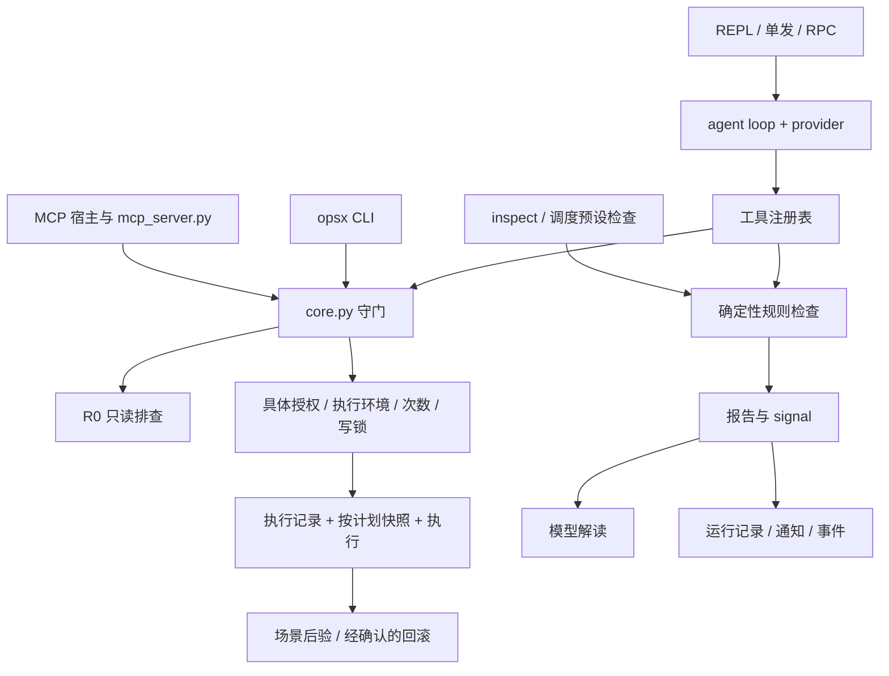

# 我给运维 Agent 打了第一个版本号，先把这张地图摊开

> 《ops-agent 建造笔记》系列总览
> 代码基线：[v0.1.0-rc.1](https://github.com/mengbin92/ops-agent/tree/v0.1.0-rc.1)，提交 `d897d2c95e70`。
> 2026-10-25 更新；这是已发布的候选版，本版真实环境及连续 7 天验收尚未完成。

---

## 0. 第一个版本号，先固定我正在解释什么

给这个项目打上 `v0.1.0-rc.1` 时，我回头看了这十二篇文章。单独看，每篇都在回答一个具体问题：一条命令谁来批准，SSH 断线后能不能重试，巡检没跑怎么发现，备份恢复后旧审批还能不能用。把它们放在一起，最先需要解释的反而是这些机制怎样接起来。

所以我补一张地图，也把代码基线固定下来。文章中的函数、配置和默认行为都对应这个 tag；以后 `main` 继续变化，也不会悄悄改变这些解释的含义。

这个版本已经能作为源码候选版下载，运行时是 Python 3.9+ 标准库，目标平台是 macOS/Linux。外部的 SSH、Docker、systemd、kubectl 或模型服务，按实际使用的功能另外准备。我的目标一直很具体：让排查过程有证据，让写操作有明确的人工授权，让执行结果不确定的时候停下来核实。

后文的 W1–W8 是路线图的工作包编号；W8 对应恢复演练与发布验收。

## 1. 我把“看见”和“改动”接成两条链

第一条链采集状态、整理证据、解释异常和发送通知。第二条链在获得具体授权后执行变更，再记录命令结果、验证业务状态，必要时准备回滚。这两条链共享守门和状态目录，但权限、失败语义各有自己的约束。

按职责摊开，大致是这张图：



图里的 `core.py` 是各入口共用的执行约束。独立 Agent 的 bash 工具会调用它，CLI 和 MCP 也会调用它。MCP 宿主自己负责模型对话，`mcp_server.py` 提供受控工具；它没有再运行一份本项目的 Agent loop。

确定性巡检则由 `agent/checks.py` 执行固定探针并判定状态。模型可以解释采样结果，也可以继续调用只读工具取证，但规则检查本身不需要 API Key。调度里的预设检查先于模型运行，模型从第一轮就不可用时，已经保存的规则异常仍能进入运行记录和通知处理。

这张图对应的是职责关系。不同入口经过的节点不同，MCP 在该版本只支持本机执行，也没有和 REPL 共用一份自动恢复的会话。入口差异放在[第 10 篇](10-four-forms-one-kernel.md)。

## 2. 从一次巡检往回看，证据要留下什么

我可以先用一个独立状态目录，只查本机：

```sh
git clone --branch v0.1.0-rc.1 https://github.com/mengbin92/ops-agent.git
cd ops-agent
./opsx selftest

article_state_dir="$(mktemp -d)"
OPSX_STATE_DIR="$article_state_dir" ./opsagent inspect --target local
```

最后一条会把报告写进这份临时状态目录。新目录没有服务清单，检查结果通常会包含“未配置 services”，结论为“不完整”、退出 3。我希望保留这个区别：主机能够连接，不代表业务已经检查过。

巡检固定检查连通性、资源和服务三组，单项只有 `ok / warn / critical / unknown / error` 五种状态。报告要保留目标、观测值、阈值、采样时间和探针命令。采不到的时候留下缺口；只有覆盖与采集都完整、没有异常时，才可能给出正常结论。[第 2 篇](02-deterministic-inspection.md)讲的就是这条边界。

接到定时任务以后，还多出一层问题：这次检查有没有真的开始、什么时候结束、有没有超时或中断。`runs/` 记录一次巡检任务，`reports/` 放报告，`signals/` 保存供调度和通知取回的规则结果。`running`、`timeout`、`interrupted` 和 `missed` 各有含义，不能靠一句“巡检完成”互相替代。[第 6 篇](06-schedule-runs-heartbeat.md)顺着这条记录往下讲。

通知也有独立状态。`notify.json` 是渠道配置，`notify-state.json` 保存异常指纹等状态，`notifications/` 是发件箱，`events.jsonl` 记状态变化。去重、静默和发送失败的补发，需要分别判断；检查发现异常并不等于消息已经送达。[第 3 篇](03-notify-dedup-quiet.md)把这几份状态拆开。

这次复审还补了一条程序约束：如果工具的规则采集、完整报告或摘要保存失败，调度会读取 `ToolContext.evidence_errors`，把结果降为不完整。模型最后写一句正常，覆盖不了这份内部错误状态。

## 3. 建议变成命令之前，我还要确认另一组事实

模型提出重启建议，距离真正执行还隔着具体命令、实际目标、影响与恢复计划的确认。审批戳绑定命令和执行环境，包含目标连接信息、工作目录及相关 Kubernetes 作用域；批准以后改了目标或环境，需要重新批准。

实际写操作通过 `ops_exec` 或 `opsx exec` 进入目标写锁、执行记录、快照计划与审批次数校验。一次授权默认只允许一次执行，快照按本次提供的参数采集；系统没有凭空生成业务备份的能力。R0 的静态判断、敏感读取限制和人工确认的边界放在[第 1 篇](01-why-read-only-default.md)。

执行记录保留五种状态：`running / succeeded / failed / unknown / aborted`。其中 `unknown` 表示命令可能已经生效，不能确定。SSH 断开以后，本机 SSH 进程停止，并不能据此推断远端命令没执行。未核实的未知记录会阻止同目标同命令重放，后续由人观察实际状态，再记录核实结果。[第 4 篇](04-remote-exec-unknown.md)解释为什么我愿意在这里多留一道人工步骤。

命令退出 0 也不等于业务恢复。`scenario.py` 将固定场景的预检、执行和后验接起来，`execution.status` 与场景 `verdict` 分别描述命令和验证结果。文件回滚要单独确认，恢复配置之后可能还需要重新批准 reload/restart，再检查服务。这部分在[第 5 篇](05-change-scenarios.md)，包括 nginx reload 前快照究竟保存了哪一份配置。

这个版本继续收窄了 shell 边界：危险选项会在引号和转义解码后检查；动态参数、能拼出写选项的展开以及动态 Kubernetes 资源名受到限制。本机内容 glob 逐项复核敏感路径和软链接目标，远程内容 glob 与内容 brace 展开保守拒绝。这会增加需要明确路径或人工确认的情况，我把这些兼容变化写进了发布说明。

## 4. 状态目录里放着几种不同的“记住”

会话记住模型与工具说过什么，长期记忆记住确认过的事实，技能文件记住可重复使用的排查步骤。这三者没有合并成同一个知识库。尤其是子代理：它用独立提示与只读工具集合，不会自动注入主代理的长期记忆。[第 8 篇](08-skills-and-memory.md)讲的是这些差别。

为了让进程退出后还能追溯，一部分状态必须落盘：运行记录、规则摘要、发件箱、审批、执行记录和快照。共享目录省去了额外的同步机制，也意味着备份时要面对这些状态的不同含义。

`opsx state backup` 保存原始字节，包括凭据和快照原件。恢复要进入一个全新目录，旧审批隔离，排期、通知和活动目标暂停，运行中的记录转为待核实或中断。这样恢复的是一份需要人工检查后启用的状态，而不会凭旧进程和旧授权自动继续做事。[第 9 篇](09-state-backup-recovery.md)还会说明 `--quiesced` 为什么仍是人工停写声明，哈希为什么不能认证备份来源。

成本状态也在这张地图里。`usage.py` 先预占调用次数，再记实际或估算 token；失败请求同样计数。provider 的有限重试和调度任务外层重试分别有自己的边界，已经交付部分流式输出的请求不会自动重来。[第 7 篇](07-budget-backoff.md)把这两层重试和预算分开算。

## 5. 这个候选版本已经证明了哪些事

我把“通过”分开写，便于回到具体证据，而不是把它们加成一个很大的数字。

| 证据 | 这个版本的结果 | 覆盖范围 |
| --- | --- | --- |
| 内置自检与独立回归 | 309 项 + 223 项；其中本轮新增 52 项独立回归 | 守门、状态机、协议、错误处理及已复现的问题 |
| 发布验证矩阵 | Ubuntu/macOS × Python 3.9/3.12 四组通过 | 相同 tag 对应提交在四种组合上的编译、自检、回归与本地演练 |
| W8 本地演练 | 10/10；24 项参与代码/策略摘要绑定 | 真实本地进程、文件和回环 HTTP，模型与通知使用本地桩 |
| 源码发布制品 | 精确 tag 的源码包、`SHA256SUMS` | 发布后下载校验，并核对源码内容与标签提交一致 |
| 本版 W8 外部验收 | 未完成 | 真实 SSH、真实模型服务、通知渠道及修复后连续 7 天观察 |

状态备份恢复另有 `tests/test_w8_state_backup.py` 等回归，不能算作那 10 项场景恢复演练的一部分。测试通过也没有把静态命令分类变成完整 shell 沙箱，更没有证明所有实际主机与服务都适配。[第 11 篇](11-testing-and-reviews.md)继续讲这些证据怎样组织，以及复审如何把已知缺陷变成回归。

版本本身也有一条可追溯的链：更新发布说明、CHANGELOG、README 和 VERSION，先经过 `develop` 检查，再进入 `main` 和 tag；Release workflow 核对标签、提交与文档，四组矩阵成功以后才生成源码包和发布页面。`v0.1.0-rc.1` 的候选标记和外部验收待完成的状态一起保留。

## 6. 接下来，我会沿着缺口继续走

十二篇专题里有不少有意留下的空白：没有通用 DAG，没有向量记忆，没有 Web/IM 对话壳，也没有无审批自动自愈。它们各自有实现成本，而我首先要把已有链路在测试环境里验证清楚。

现阶段排在前面的仍是本版 W8 的真实环境验收和连续观察。宿主完全宕机时如何从外部观察心跳、静态阈值什么时候需要重做、未知状态如何可靠核实，都要靠下一轮证据继续回答。[第 12 篇](12-design-decisions-ledger.md)把这些决定与欠账放在一起。

总览到这里，具体机制交给各篇。目录里的每条源码链接都固定在同一个版本，我希望回头核对时，文章讲的事情和打开的代码仍然对得上。

---

代码与证据：

- [`opsagent`](https://github.com/mengbin92/ops-agent/blob/v0.1.0-rc.1/opsagent)、[`mcp_server.py`](https://github.com/mengbin92/ops-agent/blob/v0.1.0-rc.1/mcp_server.py) 与 [`agent/tools.py`](https://github.com/mengbin92/ops-agent/blob/v0.1.0-rc.1/agent/tools.py)：入口与工具边界
- [`agent/checks.py`：确定性检查与规则摘要](https://github.com/mengbin92/ops-agent/blob/v0.1.0-rc.1/agent/checks.py)
- [`agent/schedule.py`：运行记录与结论收尾](https://github.com/mengbin92/ops-agent/blob/v0.1.0-rc.1/agent/schedule.py)
- [`core.py`](https://github.com/mengbin92/ops-agent/blob/v0.1.0-rc.1/core.py) / [`execution.py`](https://github.com/mengbin92/ops-agent/blob/v0.1.0-rc.1/execution.py)：审批、快照和执行记录
- [本次审查与 52 项新增回归的对应关系](https://github.com/mengbin92/ops-agent/blob/v0.1.0-rc.1/docs/reviews/2026-10-24-project-review.md)
- [发布说明与发布流水线结果](https://github.com/mengbin92/ops-agent/releases/tag/v0.1.0-rc.1)

[返回系列目录](README.md) · [从第 1 篇开始](01-why-read-only-default.md)
